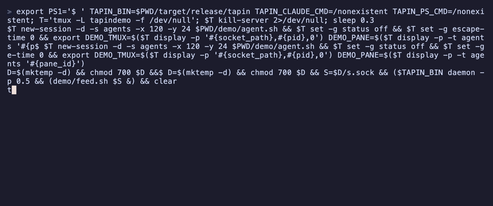

# tapin

**An inbox for your AI coding agents. Approve, jump, done.**

[](https://github.com/Thevi99/tapin/actions/workflows/ci.yml)
[](LICENSE)



You run Claude Code in three projects and Codex in a fourth. Every few minutes one of them stops and waits for you, but you can't see which one without alt-tabbing through every pane. tapin shows every session in one terminal inbox and puts the ones waiting on you at the top.

## Quickstart

```bash
brew tap Thevi99/tap && brew install tapin   # or: cargo install tapin
tapin init                                   # shows the exact change to each agent's config, asks first
tapin                                        # open the inbox
```

Or use the prebuilt binary for macOS or Linux, with no Rust needed:

```bash
curl --proto '=https' --tlsv1.2 -LsSf https://github.com/Thevi99/tapin/releases/latest/download/tapin-installer.sh | sh
```

`tapin` works before `init` too. In passive mode it reads your sessions from outside, with no setup. `init` adds approvals from the inbox and instant updates.

## Highlights

- **Sorted by what needs you.** Permission requests come first, then finished turns, then busy agents, then idle ones. The cursor goes to the oldest request.
- **`y` / `n` to approve or deny**, with the full command shown under the row. Nothing you haven't seen in full can be approved: input too long to show is deny-only.
- **`Enter` jumps to the agent.** It switches to its tmux pane (across sessions), its iTerm2 or Terminal.app tab, or its WezTerm pane.
- **Desktop notifications** when an agent needs you or finishes. If you run agents in bypass mode, you still know the moment one is done.
- **Zero-setup passive mode.** It reads Claude Code's `claude agents --json` and Codex's session files. It's read-only.
- **See who's who at a glance.** Each row carries its agent's own mark: `✻` Claude, `>_` Codex, `✦` Gemini.
- **How full each context is.** `ctx 64%` turns yellow at 80% and red at 95%. It's read from the agent's own transcript. If the window size isn't known for sure, the row shows the size instead (`ctx 132k`).
- **In your status bar.** `tapin status` prints `NEEDS 1 · DONE 2` for tmux or your prompt (see below).
- **One small binary.** Rust, no runtime, macOS and Linux.

## Agent support

| | Status | Approve from tapin | Passive (no hooks) | Jump |
|---|---|---|---|---|
| **Claude Code** | ✓ | ✓ (Claude's own dialog stays open too) | ✓ | ✓ |
| **Codex CLI** | ✓ | ✓ (holds up to 30s, only while the inbox is open*) | ✓ | ✓ |
| **Gemini CLI** (beta) | ✓† | – (Gemini has no hook that can answer) | – | ✓† |

† Built from Gemini's hook docs and source. It hasn't been tested against a real Gemini CLI yet, so please report anything off.

\* Codex shows its own prompt only after hooks return ([openai/codex#39835](https://github.com/openai/codex/issues/39835)). So tapin waits for an answer only while an inbox is open, and never longer than `codex_approval_timeout_secs`.

## What `tapin init` changes

- It adds one hook command per event to `~/.claude/settings.json`, `~/.codex/hooks.json` and `~/.gemini/settings.json`, for the agents it finds installed.
- It shows the diff first and asks. It writes a private backup (`*.tapin-backup-<time>`) and replaces the file atomically. Key order, your indent style and other tools' hooks are kept. A file that isn't already pretty-printed JSON gets reformatted, and the diff shows that.
- `tapin uninstall` removes exactly those entries. On a pretty-printed file, `init` followed by `uninstall` restores it byte for byte.
- Before you delete the tapin binary, run `tapin uninstall`. A hook pointing at a missing binary fails, and some agents treat a failing hook as "block".
- **Codex:** run `/hooks` in Codex once to trust tapin's hooks. tapin never marks hooks as trusted itself.
- **Gemini:** hooks run only in folders you've trusted in Gemini.

Run `tapin doctor` to see what's set up. It also tells you why approvals might not reach tapin: another app's hook answering first, bypass mode, or broad allow rules.

## Privacy and safety

- **Local only.** There is no network access. Sessions travel over a Unix socket that only your user can open (0600, in a directory nobody else can write).
- **Hooks fail open.** If tapin isn't running, is slow, or crashes, the agent carries on as if tapin weren't installed. A timeout never denies anything. The hook never exits with an error code an agent would read as "block".
- **Answers are tied to one request.** A stale or duplicate `y` can't approve a newer request.
- Any process running as *your* user can talk to the socket. That's the same trust boundary as your agent's own settings file. See [#12](https://github.com/Thevi99/tapin/issues/12).

## Keys

| Key | Does |
|---|---|
| `Enter` | jump to the agent's pane or window |
| `Tab` | next agent waiting on you (a request or a finished turn) |
| `/` | filter by project, agent, detail or folder (`Esc` clears) |
| `g` | group rows by folder |
| `y` / `n` | approve / deny the selected request |
| `d` | details: full input, last message, cwd, where it runs |
| `?` | help |
| `Esc` | close details or help |
| `j` `k` / `↑` `↓` | move |
| `q` | quit (the background daemon keeps running) |

## Status bar

`tapin status` prints one line, such as `NEEDS 1 · DONE 2`. It prints nothing when nothing is waiting or when tapin isn't running, and it never starts the daemon. For tmux:

```tmux
set -g status-right '#(tapin status) %H:%M'
set -g status-interval 5
```

## Config

The config file is optional: `~/.config/tapin/config.toml`.

```toml
notify = true                     # desktop notifications
notify_on = ["needs", "done"]     # which transitions notify
bell = false                      # terminal bell on new requests (works over SSH)
approval_timeout_secs = 300       # how long a Claude request waits for tapin (max 590)
codex_approval_timeout_secs = 30  # Codex shows no prompt while waiting, so this is short
passive_poll_secs = 2             # passive mode poll interval
hide_dirs = ["~/.claude-mem"]     # leave out sessions in these folders (default: claude-mem's observer)
```

If the file has a mistake, tapin ignores it and uses the defaults. The error shows at the bottom of the TUI and in `tapin doctor`.

## How it compares

[agtop](https://github.com/ldegio/agtop) and [agenttop](https://github.com/vicarious11/agenttop) are good monitors: they show what your agents are *doing*. tapin is built for *acting* on them.

| | agent monitors | tapin |
|---|---|---|
| Sort order | activity, tokens | what needs you |
| Approve or deny a request | – | ✓ |
| Jump to the session | – | ✓ |
| Notify when one needs you or finishes | – | ✓ |

## How it works

The agents' hooks run `tapin hook`, which forwards each event to a small background daemon over a Unix socket. The TUI subscribes to the daemon. For a permission request, the hook waits for your `y`/`n` and returns it as the agent's documented hook decision. Passive mode feeds the same inbox from `claude agents --json` and Codex's session files.

## Building from source

```bash
git clone https://github.com/Thevi99/tapin && cd tapin
cargo test && cargo install --path .
```

The tests never touch your real agent configs. `.cargo/config.toml` points them at `target/`. To try tapin without changing your settings, use `claude --settings examples/claude-settings.json`. To re-record the demo, run `vhs demo/demo.tape` (needs vhs and tmux).

## License

MIT

tapin is an independent project. It is not affiliated with or endorsed by Anthropic, OpenAI or Google. Claude, Codex and Gemini are trademarks of their owners.
